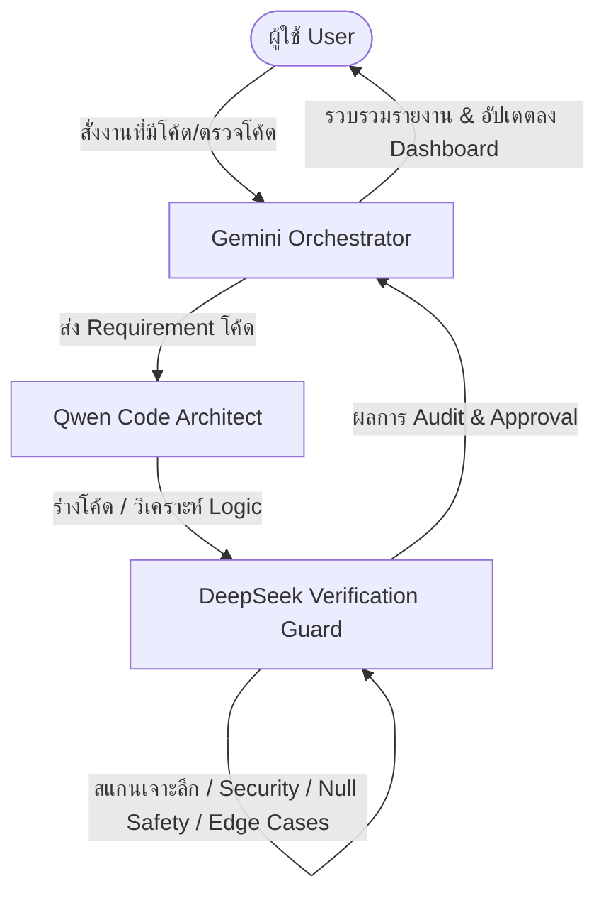

# 🛡️ ข้อตกลงสถาปัตยกรรม Multi-Agent (ฉบับปรับปรุงตามคำสั่งผู้ใช้)

> **สรุปเงื่อนไขการทำงานชัดเจน:**
> 1. **ถามตอบทั่วไป / คุยเล่น / สอบถามสถานะ / ข้อมูลทั่วไป (ไม่มีโค้ด ไม่เจาะลึก)** ➔ **Gemini ตอบได้เลยทันทีคนเดียว** เพื่อความรวดเร็วและกระชับ ไม่ต้องเรียก Qwen หรือ DeepSeek
> 2. **เมื่อใดก็ตามที่มีเรื่อง "โค้ด" (เขียนโค้ด, แก้ไข, Audit, เช็ค Logic, XML, สถาปัตยกรรม, Debug)** ➔ **ต้องทำงานร่วมกันทั้ง 3 ฝ่ายเสมอ (Gemini + Qwen + DeepSeek)** โดย Gemini ห้ามทำคนเดียว

---

## 🏛️ ตารางแบ่งหน้าที่และเงื่อนไขการทำงาน

| ประเภทงาน / คำถาม | Gemini (Orchestrator) | Qwen (Code Architect) | DeepSeek (Verification Guard) |
| :--- | :---: | :---: | :---: |
| **ถามตอบทั่วไป** (เช่น "กี่โมงแล้ว", "ลิงก์เข้าได้ไหม", "อธิบายฟีเจอร์หน่อย") | ตอบทันที | 💤 พัก | 💤 พัก |
| **ออกแบบโครงสร้างโค้ด / ฟังก์ชัน / Layout XML** | คุม Flow | ✍️ ออกแบบ & เขียนโค้ด | 💤 รอตรวจ |
| **ตรวจสอบโค้ด / แกะ Logic / หา Bug / Zero-Defect** | คุม Flow | อธิบายการทำงาน | 🔍 สแกนเจาะลึก & Audit |
| **สรุปผลและรายงานผู้ใช้** | รวบรวม & รายงาน | ให้ข้อมูลเทคนิค | อนุมัติความปลอดภัย (Pass/Fail) |

---

## ⚡ ขั้นตอนเมื่อมี "โค้ด" เข้ามาเกี่ยวข้อง

