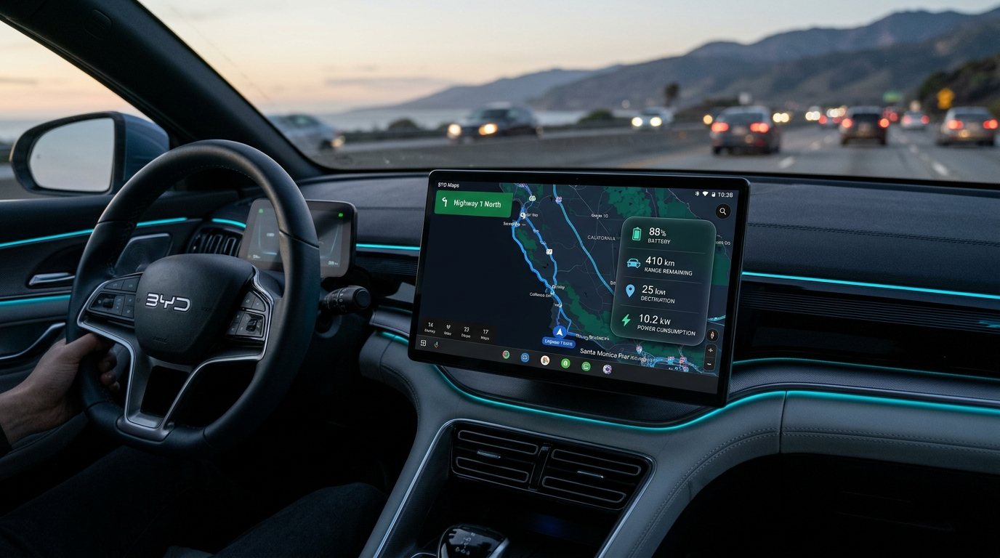

# ⚡ BYD Smart EV Route & Battery Overlay

<p align="center">
  <a href="https://github.com/NongJuum/BYD-Maps-Battery-Overlay/releases/latest">
    
  </a>
</p>

<p align="center">
  <a href="README.md"><b>English</b></a> | <a href="README_TH.md"><b>🇹🇭 ภาษาไทย</b></a>
</p>

<p align="center">
  <b>A smart, real-time floating overlay application that predicts destination battery percentage (SoC %) and actual remaining range for all BYD electric vehicles.</b><br>
  Works seamlessly alongside Google Maps and directly reads telemetry from vehicle internal systems (OBD / BMS / CAN bus) without requiring any extra OBD dongles or external hardware.
</p>

<p align="center">
  
  
  
  <a href="https://www.buymeacoffee.com/nongjuum"></a>
  
</p>

<p align="center">
  
</p>

---

### 👨‍💻 Developer & Author
- **Developer:** Nontarat Hasitapong
- **Contact / Support Email:** [canon.non.7@gmail.com](mailto:canon.non.7@gmail.com)

---

## 🌟 Key Features

- **🏁🔋 Destination Battery Prediction (Destination SoC %)**:
  - Calculated using actual remaining battery energy (kWh) from the BMS + real-time rolling average consumption of the last 50 km (Past 50 km) + remaining distance from Google Maps turn-by-turn navigation.
  - Displays as a **safe prediction range (with a built-in 2% safety buffer)**, e.g. `88-90%` or `48-50%`, accounting for traffic jams, heavy AC usage, and uphill driving conditions.
  - Automatically recalculates in real-time on route changes, traffic reroutes, or missed turns.
- **🚗 Real-World Remaining Range**:
  - Displays accurate kilometers based on actual recent driving style and consumption, avoiding misleading dashboard NEDC figures.
- **⚠️ Smart Tri-Color Alert System**:
  - 🟢 **Green**: Battery is well sufficient for the planned route.
  - 🟡 **Yellow (`⚠️🪫`)**: Warning when current or destination battery is expected to drop below 20%.
  - 🔴 **Red (`⚠️🔌`)**: Critical alert when battery is insufficient to reach the destination (<2% at arrival), urging the driver to plan a charging stop.
- **📡 Direct OBD / BMS Integration**:
  - Communicates directly with the BYD vehicle subsystem without needing third-party OBD2 Bluetooth/Wi-Fi adapters.
  - Supports all BYD models: **Dolphin** (Standard/Extended), **Atto 3**, **Seal** (Dynamic/Premium/Performance), **M6**, **Sealion 6 DM-i**, **Sealion 7**, and more.
  - Includes presets for various battery capacities as well as custom battery size (kWh) and Battery Health (SOH %) override.
- **🗺️ Universal Google Maps Compatibility**:
  - Compatible with Google Play Store, Aurora Store, Morphe, Vanced/ReVanced, MicroG, GBox, Gspace, and GPad.
  - Works on standard BYD DiLink infotainment screens and custom launchers like **DUDUOS Launcher (including Picture-in-Picture / PIP mode)**.
- **🖐️ Fully Customizable Floating Pill (Movable & Pinch-to-Scale)**:
  - Clean, minimal floating pill that doesn't obstruct navigation.
  - Drag and drop anywhere on the screen (even over the top system status bar).
  - Use 2-finger pinch gesture to resize smoothly.

---

## 📊 Floating Pill Symbol Guide

> `⠿` | `🏁🔋 88-90%` | `🚗 410 km` | `📍 25.4 km` | `⚡ 10.2` | `⚠️🔌`

| Symbol | Description |
| :---: | :--- |
| **`⠿`** | Drag handle: touch and drag to reposition the overlay anywhere on screen |
| **`🏁🔋`** | Expected battery level at destination with a 2% safety margin |
| **`🚗`** | Real-world remaining driving range based on BMS data and recent 50km consumption |
| **`📍`** | Remaining distance to destination provided live by Google Maps |
| **`⚡`** | Vehicle's average energy consumption for the last 50 km (kWh/100km) |
| **`⚠️🪫`** | Yellow Warning: Battery is below 20% |
| **`⚠️🔌`** | Red Warning: Insufficient power to reach destination. Charging stop needed! |

---

## 📦 Prerequisites & App Dependencies

- **🚗 Supported Vehicles:** All BYD electric and DM-i vehicles running Android-based DiLink (DiLink 3.0, 4.0, 5.0), including Dolphin, Atto 3, Seal, M6, Sealion 6 DM-i, Sealion 7, etc.
- **🔌 Hardware Dongles:** **None required!** (No OBD2 scanner or Bluetooth/Wi-Fi adapters needed; reads directly from vehicle CAN bus / BMS).
- **📱 Third-Party App Dependencies:** **None! 100% Standalone.**
  - Does NOT require OverDrive, DUDU Launcher, Tasker, or Shizuku to function.
  - Fully compatible with stock BYD DiLink UI as well as custom launchers (such as DUDU Launcher).
- **🗺️ Navigation App:** **Google Maps** installed on the head unit (compatible with Play Store, Aurora Store, MicroG, Vanced, GBox, Gspace, etc.) so that the overlay can read turn-by-turn distance and calculate destination battery percentage.

---

## 📥 Installation & Activation Guide

### Step 1: Install APK
1. Download the prebuilt **[BYD-Maps-Battery-Overlay-Universal.apk (Direct Download)](https://github.com/NongJuum/BYD-Maps-Battery-Overlay/releases/download/v1.0.0/BYD-Maps-Battery-Overlay-Universal.apk)** from [GitHub Releases](https://github.com/NongJuum/BYD-Maps-Battery-Overlay/releases/latest).
2. Copy the `.apk` file to a USB flash drive, plug it into the car's USB port, and install via the native **File Manager**.
3. Open **BYD Maps Battery** and grant the required Overlay and Notification Listener permissions.

---

### Step 2: One-Time Vehicle Telemetry Activation via ADB
> ⚠️ **Why is this required?**  
> On BYD DiLink firmware (DiLink 3.0 / 4.0 / 5.0), the vehicle CAN bus / battery statistics permission (`BYDAUTO_STATISTIC_GET`) is protected by OEM signature. Just like other prominent BYD apps (**OverDrive** and **DUDU Launcher**), a background reader running as ADB Shell (UID 2000) is required:

1. Connect your computer to the same Wi-Fi network as the vehicle head unit (or use mobile hotspot).
2. Note your head unit's IP address in Wi-Fi settings (e.g., `10.51.77.234` or `192.168.1.xxx`).
3. Run the following command in Terminal / PowerShell on your computer:
   ```bash
   adb connect <CAR_IP_ADDRESS>:5555
   adb shell "CLASSPATH=\$(pm path com.byd.mapsoverlay | cut -d: -f2) app_process / com.byd.mapsoverlay.BydTelemetryDaemon </dev/null >/dev/null 2>&1 &"
   ```
4. Check the head unit screen: live Battery SoC %, real range, and 50km power consumption will immediately start updating!

> **💡 Notes:**
> - Fully compatible alongside **OverDrive** (operates on dedicated port **19890** with zero port collisions).
> - Whenever Google Maps navigation starts, the pill overlay displays automatically.

---

### Step 3: Configure Auto-Start & Background Keep-Alive
To ensure the overlay service starts reliably and is not terminated by DiLink's aggressive power management:

#### 1. Whitelist via ADB (Recommended)
Run the following commands in Terminal / PowerShell:
```bash
adb shell "dumpsys deviceidle whitelist +com.byd.mapsoverlay"
adb shell "appops set com.byd.mapsoverlay RUN_IN_BACKGROUND allow"
adb shell "appops set com.byd.mapsoverlay RUN_ANY_IN_BACKGROUND allow"
adb shell "appops set com.byd.mapsoverlay START_FOREGROUND allow"
```

#### 2. Enable in BYD App Start Management
1. Navigate to **Vehicle Settings** -> **App Management** -> **App Start Management** (or Auto-Start Management).
2. Find **BYD Maps Battery** and toggle the switch to **Allow Auto-Start**.
   *(You can also launch this screen directly via ADB: `adb shell "am start -n com.byd.appstartmanagement/.frame.AppStartManagement"`)*

---

### 📱 Reactivation Without a PC (Using Android Smartphone)
> **💡 When is this needed?**  
> During regular daily use (parking, locking the vehicle), BYD DiLink enters deep sleep (Suspend to RAM) with all processes retained in memory—**no reactivation required**.  
> If you perform a complete **cold reboot** of the head unit (e.g., holding the steering wheel scroll wheel for 10 seconds or following an OTA system update), you can easily revive the daemon in seconds using your Android smartphone without a PC:

1. Install the free **[Bugjaeger Mobile ADB](https://play.google.com/store/apps/details?id=eu.sisik.hackendebug)** app from Google Play Store on your Android phone.
2. Connect your smartphone to the same Wi-Fi network or vehicle hotspot.
3. Open Bugjaeger &rarr; tap the **Connect** icon &rarr; enter the vehicle head unit's IP (e.g. `10.51.77.234:5555`) and tap **Connect**.
4. Go to the **Commands** or **Interactive Shell** tab, paste the command below, and press Run:
   ```bash
   CLASSPATH=$(pm path com.byd.mapsoverlay | cut -d: -f2) app_process / com.byd.mapsoverlay.BydTelemetryDaemon </dev/null >/dev/null 2>&1 &
   ```
   *(You can save this command to your Favorites in Bugjaeger for one-tap execution in the future).*

---

---

> **Tip:** You can test or position the overlay anytime by tapping **"👁️ Test / Show Overlay"** in the app settings screen.

---

## ☕ Support & Donations

> **💡 Open Source & Community Spirit:**  
> Anyone is welcome to use, fork, modify, or improve this project freely!  
> However, if you find this project valuable and would like to show some kindness, treating the developer to a small **candy, treat, or coffee** is always warmly welcomed and deeply appreciated! 🙏🍬☕❤️

<p align="center">
  <a href="https://www.buymeacoffee.com/nongjuum" target="_blank">
    
  </a><br><br>
  <br>
  <b><a href="https://www.buymeacoffee.com/nongjuum">buymeacoffee.com/nongjuum</a></b><br>
  <i>(Supports Debit/Credit cards, Apple Pay, Google Pay)</i>
</p>

### 🌐 Other Channels:
- **Skrill:** `canon.non.7@gmail.com`

---

## 📄 License & Attribution

- **Developer:** Nontarat Hasitapong
- **License:** MIT License. Free for personal EV community use.
