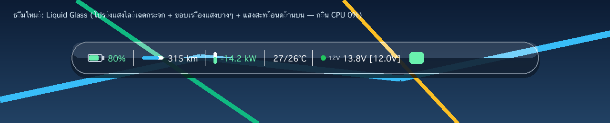
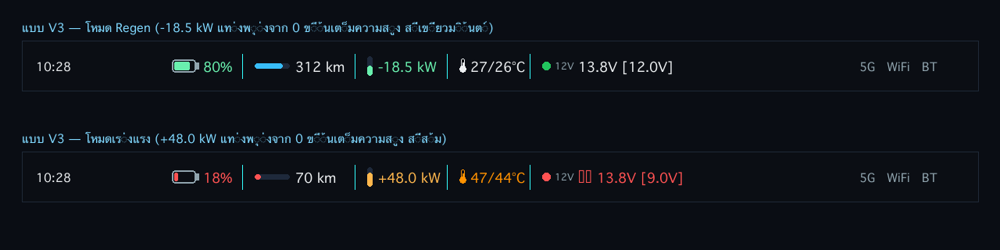
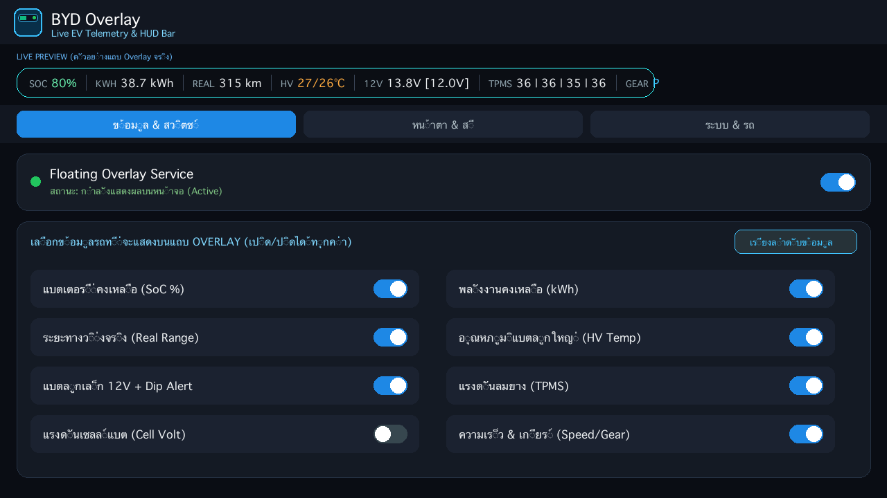

# ⚡ BYD Overlay — Live EV Telemetry & HUD Bar

  

  
  
  

  <a href="README.md"><b>English</b></a> | <a href="README_TH.md"><b>🇹🇭 ภาษาไทย</b></a>

  <b>A lightweight, zero-lag floating telemetry HUD Overlay built specifically for BYD electric vehicles (DiLink 3 / 4 / 5).</b> 
  Reads live CAN-Bus &amp; BMS data directly from the vehicle — no external OBD dongle required.

---

## ✨ Visual HUD Widgets (Zero-Lag, ~0% CPU)

  

- **🔋 Dynamic Battery Icon (`SoC %`):** Phone/Tesla-style fill bar that dynamically scales &amp; changes color (Green `>50%`, Amber `20–50%`, Red `<20%`).
- **📏 Real Range Progress Bar (`km`):** Compact visual bar paired with real-world calculated remaining range.
- **⚡ Full-Height Vertical Power Bar (`kW`):** Rises from `0` at the bottom — **Mint Green** on Regen (`-kW`), **Cyan** on normal drive, **Amber** on high power (`>30 kW`).
- **🌡️ BYD LFP Blade Battery Thermal Icons &amp; Standards:**
  | Max Cell Temp | BYD LFP Status | Visual Indicator |
  | :--- | :--- | :--- |
  | `< 15°C` | Cold (Reduced Regen/Charge) | ❄️ Blue (`#40C4FF`) |
  | `15°C – 39°C` | Optimal Operating Window | 🌡️ Theme Color |
  | `40°C – 44°C` | Warm (Active Cooling) | 🌡️ Yellow (`#FFD54F`) |
  | `45°C – 54°C` | High (DC Derating Zone) | 🔥 Orange (`#FF9100`) |
  | `≥ 55°C` | Critical Thermal Warning | 🔥 Red (`#FF5252`) + Gentle Pulse |
- **🔋 12V Aux Battery + Lowest Start Dip Detection:** Tracks the lowest 12V voltage drop since vehicle wake (`13.8V [12.0V]`) with a green/red health dot. Alerts with red pulsing `⚠️ 13.8V [9.0V]` if dip drops `< 9.5V`.
- **🔬 HV Cell Voltage &amp; Imbalance (`ΔmV`):** Displays `Max/Min V` + real-time cell delta (`Δ5mV`), turning Amber (`≥30mV`) or Red (`≥50mV`) when LFP AC 100% balancing is recommended.
- **🛞 4-Tire TPMS (`PSI / kPa`):** Live 4-wheel pressure with red pulsing alert when any tire drops `< 35 PSI`.
- **🏎️ Color-Coded Gear Badge (`P / D / R / N`)** &amp; **Eco Consumption (`kWh/100km`)** coloring (`<12` Eco Green, `>16` Heavy Amber).

---

## 🎨 Customization, Themes &amp; 3-Tab Settings UI

  

- **Pinned Live Preview Bar:** Always visible at the top of Settings — every toggle, field reorder, color, background theme, and scale adjustment updates the preview instantaneously.
- **Compact 3-Tab Layout:** Split cleanly into **📊 Fields &amp; Switches**, **🎨 Style &amp; Colors**, and **⚙️ System &amp; Vehicle** — no endless scrolling on landscape car screens.
- **Display Modes:**
  - **Stock Status Bar Mode:** Optically centered (`+6px`) right in the middle of the BYD top status bar, with `FLAG_LAYOUT_IN_OVERSCAN` and automatic 6-second Z-order keep-alive so SystemUI never covers it.
  - **Floating Pill Mode:** Draggable anywhere on screen, supports horizontal &amp; vertical layouts.
- **Themes:** **💧 Liquid Glass** (frosted translucent glass with top specular sheen &amp; luminous rim, 0% GPU blur overhead), **OLED Black**, **Midnight**, **Transparent**, plus 4 text color themes (`White`, `Cyan`, `Emerald`, `Amber`).
- **Custom Field Order:** Reorder any metric on the bar to your exact preference.

---

## 🚀 Quick Installation

1. Download **`BYD-Maps-Battery-Overlay-Beta.apk`** directly from this repository.
2. Install on your BYD DiLink head unit (via USB flash drive or `adb install -r BYD-Maps-Battery-Overlay-Beta.apk`).
3. Open **BYD Overlay**, grant **Display over other apps**, and toggle **Floating Overlay Service** ON.
4. *(Built-in ADB Wake Backoff)* Automatically avoids colliding with Kinex / Overdrive local ADB sessions on vehicle wake.
