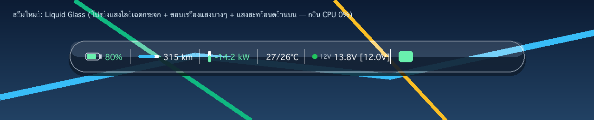
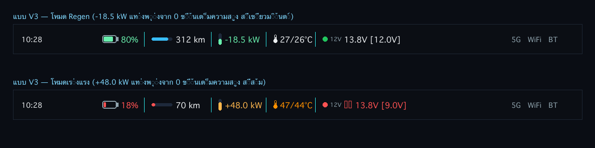
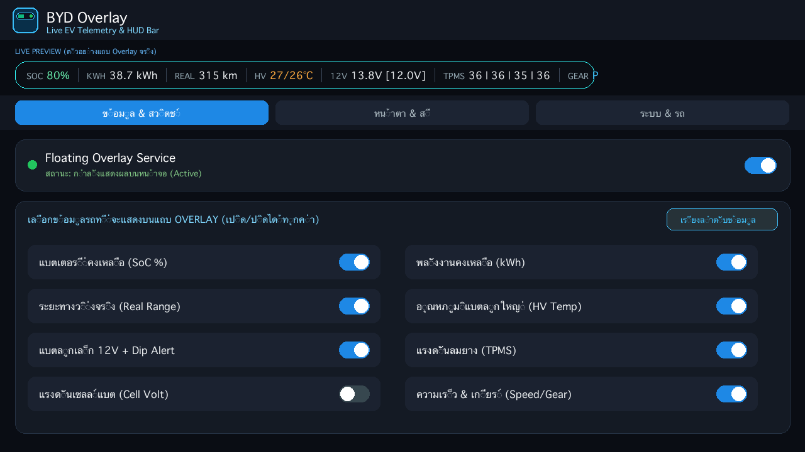

# ⚡ BYD Overlay — แถบลอยข้อมูลรถ EV แบบเรียลไทม์

  

  
  
  

  <a href="README.md"><b>English</b></a> | <a href="README_TH.md"><b>🇹🇭 ภาษาไทย</b></a>

  <b>แอปพลิเคชัน HUD แถบลอยข้อมูลรถ EV ที่เบาและลื่นที่สุด ออกแบบพิเศษสำหรับรถยนต์ไฟฟ้า BYD (DiLink 3 / 4 / 5) โดยเฉพาะ</b> 
  ดึงข้อมูลตรงจากกล่อง CAN-Bus และ BMS ของรถแบบ Real-time โดยไม่ต้องเสียบอุปกรณ์ OBD ภายนอกเสริม!

---

## ✨ กราฟิกแบบ Visual HUD Widget (เบา ลื่น กิน CPU ~0%)

  

- **🔋 ไอคอนแบตแบบมือถือ (`SoC %`):** มีกรอบ + ขั้วแบต + หลอดไฟข้างในยืด-หดตามเปอร์เซ็นต์จริง เปลี่ยนสีอัตโนมัติ (เขียว `>50%`, ส้ม `20–50%`, แดง `<20%`)
- **📏 ขีดหลอดระยะทาง (`Range Bar`):** แสดงหลอดระยะทางวิ่งได้จริงคู่กับตัวเลข `km`
- **⚡ แท่งกำลังไฟแนวตั้งขึ้นจาก 0 (`kW`):** พุ่งขึ้นเต็มความสูงข้างตัวเลข — **สีเขียวมิ้นต์** ตอนชาร์จไฟกลับ (Regen `-kW`), **สีฟ้า** ตอนขับปกติ, **สีส้ม** ตอนเร่งแรง (`>30 kW`)
- **🌡️ อุณหภูมิแบตลูกใหญ่ (อิงมาตรฐาน BYD LFP Blade Battery):**
  | อุณหภูมิสูงสุด (Max Temp) | สถานะจริงของแบต LFP | สัญลักษณ์และสี |
  | :--- | :--- | :--- |
  | `< 15°C` | เย็นจัด (ลดกำลังชาร์จ/Regen) | ❄️ สีฟ้า (`#40C4FF`) |
  | `15°C – 39°C` | ปกติ / เหมาะสมที่สุด (Optimal) | 🌡️ สีปกติตามธีม |
  | `40°C – 44°C` | เริ่มอุ่น (พัดลม/แอร์ระบายความร้อนแบตทำงาน) | 🌡️ สีเหลือง (`#FFD54F`) |
  | `45°C – 54°C` | สูง (BMS เริ่มลดความเร็วชาร์จ DC) | 🔥 สีส้ม (`#FF9100`) |
  | `≥ 55°C` | วิกฤต (ใกล้ขีดจำกัดปลอดภัย LFP) | 🔥 สีแดง (`#FF5252`) + กระพริบ Pulse |
- **🔋 แบตลูกเล็ก 12V + จับค่าไฟตกต่ำสุดตอนสตาร์ต (Start Dip Alert):** จดจำแรงดันต่ำสุดตั้งแต่เปิดรถ (`13.8V [12.0V]`) พร้อมจุดสถานะเขียว/แดง หากไฟตกต่ำกว่า `9.5V` จะแจ้งเตือนสีแดงกระพริบ `⚠️ 13.8V [9.0V]` ทันที
- **🔬 แรงดันเซลล์แบต + ความต่างเซลล์ (`ΔmV`):** แสดง `Max/Min V` พร้อมค่าความต่าง (`Δ5mV`) เปลี่ยนเป็นสีส้ม (`≥30mV`) หรือสีแดง (`≥50mV`) เพื่อเตือนให้ชาร์จ AC 100% Balance เซลล์
- **🛞 แรงดันลมยาง 4 ล้อ (`TPMS PSI / kPa`):** แสดงครบทั้ง 4 ล้อ พร้อมแจ้งเตือนสีแดงกระพริบเมื่อล้อใดอ่อนกว่า `35 PSI`
- **🏎️ ป้ายเกียร์แบบ Badge (`P / D / R / N`)** เปลี่ยนสีตามเกียร์ (`P` ฟ้า, `D` เขียว, `R` แดง, `N` เหลือง) และ **สีอัตราสิ้นเปลือง 50 กม.** (`<12` เขียวประหยัด, `>16` ส้มกินไฟ)

---

## 🎨 การปรับแต่ง, ธีม Liquid Glass และหน้าตั้งค่า 3 แท็บ

  

- **แถบ Live Preview ปักหมุดด้านบน:** เห็นตัวอย่างแถบจริงทันทีทุกครั้งที่เปิด/ปิดสวิตช์, สลับลำดับข้อมูล, เปลี่ยนสี หรือปรับขนาด Scale
- **หน้าตั้งค่าแบบ 3 แท็บกระชับ:** แยกหมวด **📊 ข้อมูล &amp; สวิตช์** / **🎨 หน้าตา &amp; สี** / **⚙️ ระบบ &amp; รถ** ไม่ต้องไถสโครลยาวบนจอรถ
- **โหมดการแสดงผล:**
  - **โหมดแถบสถานะ (Stock Status Bar):** จัดกึ่งกลางแนวตั้ง (`+6px`) เป๊ะกับไอคอนเดิมของรถ พร้อม `FLAG_LAYOUT_IN_OVERSCAN` และระบบคง Z-Order เหนือแถบสถานะอัตโนมัติ (ไม่โดนแถบสถานะบัง ไม่ต้องกด Home)
  - **โหมดแคปซูลลอย (Floating Pill):** ลากวางได้อิสระทุกจุดบนหน้าจอ รองรับทั้งแนวนอนและแนวตั้ง
- **ธีมพื้นหลัง:** **💧 Liquid Glass** (กระจกโปร่งแสง + แสงสะท้อนด้านบน + ขอบกระจกเรืองแสง กิน GPU 0%), **ดำสนิท (OLED Black)**, **Midnight**, **โปร่งใส** และเลือกสีตัวอักษรได้ 4 สี
- **เรียงลำดับข้อมูลได้เอง:** เลือกจัดลำดับซ้าย-ขวาของแต่ละค่าบนแถบได้อิสระ

---

## 🚀 วิธีติดตั้งใช้งาน

1. ดาวน์โหลดไฟล์ **`BYD-Maps-Battery-Overlay-Beta.apk`** จาก Repository นี้
2. ติดตั้งลงบนจอรถ BYD (ผ่านแฟลชไดรฟ์ หรือ `adb install -r BYD-Maps-Battery-Overlay-Beta.apk`)
3. เปิดแอป **BYD Overlay** → อนุญาตสิทธิ์ **แสดงทับแอปอื่น (Overlay)** → เปิดสวิตช์ **Floating Overlay Service**
4. *(ADB Wake Backoff อัตโนมัติ)* มีระบบหน่วงจังหวะเช็ก Daemon ตอนรถตื่น ไม่ชนกับ Kinex และ Overdrive ครับ
