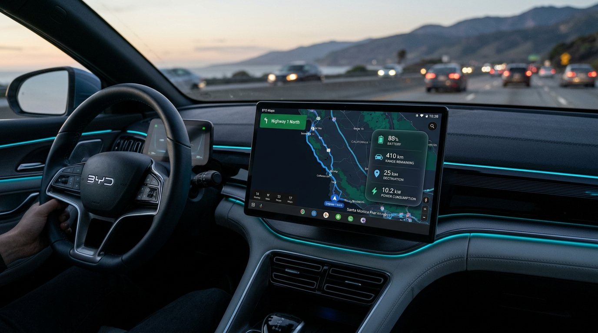

# ⚡ BYD Smart EV Route & Battery Overlay

  

  
  
  

  <a href="README.md"><b>English</b></a> | <a href="README_TH.md"><b>🇹🇭 ภาษาไทย</b></a>

  <b>แอปพลิเคชัน HUD แถบลอยอัจฉริยะ (Floating Overlay) ออกแบบพิเศษสำหรับรถยนต์ไฟฟ้า BYD (DiLink 3 / 4 / 5) โดยเฉพาะ</b> 
  คำนวณ <b>% แบตเตอรี่คงเหลือเมื่อถึงจุดหมายปลายทาง (SoC %)</b> และ <b>ระยะทางวิ่งได้จริง (Real Range)</b> แสดงควบคู่กับ Google Maps แบบ Real-time ดึงข้อมูลตรงจากกล่อง CAN-Bus และ BMS ของรถโดยไม่ต้องใช้อุปกรณ์ OBD ภายนอกเสริม!

---

## ✨ มีอะไรใหม่ในเวอร์ชัน v1.3.0-beta (อัปเกรดใหญ่ล่าสุด)

<table>
  <tr>
    <td width="50%">
      <h3>🏎️ ระบบเลือก 3 สไตล์ Layout HUD</h3>
      เลือกปรับดีไซน์แถบลอยได้อิสระตามความถนัด: <b>Modern Capsule</b> (ครบครัน), <b>Minimalist Compact</b> (สลิมบางประหยัดพื้นที่), และ <b>Vertical Flight HUD</b> (ทรงแท่งแนวตั้ง)
    </td>
    <td width="50%">
      <h3>⚡ เปิดสิทธิ์อัตโนมัติในคลิกเดียว (Zero-PC)</h3>
      ติดตั้งเสร็จแตะปุ่ม "เปิดสิทธิ์อัตโนมัติ" ในแอปบนจอรถได้ทันที ผ่าน localhost ADB ในตัว ไม่ต้องเสียบสาย ไม่ต้องต่อคอมพิวเตอร์พิมพ์คำสั่งใดๆ ให้ยุ่งยาก
    </td>
  </tr>
  <tr>
    <td width="50%">
      <h3>🧭 รองรับ Google Maps & Android Auto ทุกสาย</h3>
      อ่านค่าระยะทางแม่นยำ 100% ทั้ง <b>Google Maps ตรง, Play Store, GBox, GPack, GSpace, microG, Vanced</b> รวมถึงการแคสต์ผ่าน <b>Android Auto (ZLink / BYDLink / AutoKit)</b>
    </td>
    <td width="50%">
      <h3>🛡️ ระบบตัดปัญหา DUDU / Overdrive กวน</h3>
      มีระบบ Plausibility Guard ดักจับแยกแยะระยะทางนำทางจริง ออกจากตัวเลขความเร็ว (km/h) หรือ Trip สะสมของ Launcher อย่าง DUDUOS / Overdrive ค่าแบตเตอรี่จึงนิ่งสนิท ไม่วูบวาบ
    </td>
  </tr>
  <tr>
    <td width="50%">
      <h3>🔄 จำตำแหน่งแยกแนวนอน/แนวตั้ง</h3>
      ตรวจจับการหมุนจอ DiLink อัตโนมัติ (Portrait ↔ Landscape) บันทึกพิกัดแยกกัน และดีดกลับเข้าตำแหน่งที่คนขับตั้งไว้อย่างแม่นยำ ไม่หลุดขอบจอ
    </td>
    <td width="50%">
      <h3>📌 วางทับ Status Bar ด้านบนสุด</h3>
      ปลดล็อกขอบเขตบนสุด ให้สามารถลากแคปซูลขึ้นไปวางบนแถบ Status Bar ด้านบนได้เนียนตา ช่วยประหยัดพื้นที่แสดงผลแผนที่ได้สูงสุด
    </td>
  </tr>
  <tr>
    <td width="50%">
      <h3>🌙 Night Vision หรี่แสงอัตโนมัติ</h3>
      ซิงก์กับไฟหน้ารถและโหมดกลางคืนของระบบ DiLink หรี่แสงลงเหลือ 72% แบบ Low-Glow ทันทีเมื่อเข้าอุโมงค์หรือขับเวลากลางคืน ไม่แยงตาคนขับ
    </td>
    <td width="50%">
      <h3>🔌 คำนวณจำนวนครั้งที่ควรแวะชาร์จ</h3>
      วิเคราะห์ระยะทาง Maps และความจุแบตเตอรี่ พร้อมบอกจำนวนครั้งที่ควรแวะชาร์จด่วน DC Fast Charge (ช่วง 10% ➔ 80%) พร้อมระบบ Clamp ความปลอดภัย 1-9 ครั้ง
    </td>
  </tr>
  <tr>
    <td width="50%">
      <h3>🎯 ตัวเลขเดี่ยวอ่านง่าย (~XX%)</h3>
      แสดงตัวเลขแบตปลายทางแบบค่าเดี่ยวชัดเจน พร้อม Deadband Window ป้องกันตัวเลขกระตุกหรือวูบวาบเวลาเหยียบคันเร่งแซง
    </td>
    <td width="50%">
      <h3>📲 อัปเดตผ่านจอรถได้ทันที (OTA)</h3>
      กดอัปเดตเวอร์ชันใหม่ได้ในคลิกเดียวจากในแอปบนหน้าจอรถ ไม่ต้องใช้คอมพิวเตอร์ ไม่ต้องรัน ADB หรือเสียบแฟลชไดรฟ์ใหม่อีกต่อไป
    </td>
  </tr>
  <tr>
    <td width="50%">
      <h3>⚡ กู้คืนสถานะอัตโนมัติ (START_STICKY & Self-Healing)</h3>
      เมื่อระบบแอนดรอยด์ Low-Memory Killer (LMK) ปิดแอปชั่วคราว (เช่น ขณะเปิดกล้อง 360 รอบคัน) แอปจะฟื้นคืนชีพกลับมาทำงานต่อทันทีพร้อมดึงระยะทางและพิกัดเดิมกลับมาแสดงผลแบบไร้รอยต่อ
    </td>
    <td width="50%">
      <h3>🧠 ใช้แรมน้อยที่สุด (Ultra-Low RAM Architecture)</h3>
      กิน RAM เพียง 15–20 MB ออกแบบมาเพื่อจอ DiLink ที่ต้องรันแอปหนักๆ พร้อมกัน เช่น DUDUOS / Overdrive Launcher + Spotify + Google Maps ไหลลื่น ไม่กระตุก
    </td>
  </tr>
  <tr>
    <td width="100%" colspan="2">
      <h3>📊 คำนวณแบตเตอรี่แม่นยำด้วยค่าเฉลี่ย 50 km ล่าสุด (BYD ECU Telemetry)</h3>
      อิงอัตราสิ้นเปลืองเฉลี่ย 50 กิโลเมตรล่าสุด (Last 50km Consumption) ส่งตรงจาก ECU/BMS ของตัวรถ BYD โดยตรง ไม่ใช้ค่าเหยียบสดที่วูบวาบ ทำให้ % แบตเตอรี่ปลายทางมีความเสถียรและแม่นยำสูงสุด
    </td>
  </tr>
</table>

---

## 🎨 ระบบสีแบตเตอรี่แบบไล่เฉด 6 ระดับ (Dynamic 6-Tier Gradient)

สีของตัวเลขแบตเตอรี่ปลายทางจะเปลี่ยนไปตามระดับความปลอดภัยของการขับขี่ EV:

| ช่วง % แบตเตอรี่ | รหัสสี (Hex) | สัญลักษณ์สี | ความหมายเชิงการขับขี่จริง |
| :---: | :---: | :---: | :--- |
| **0% – 10%** | `#FF1744` | 🔴 **แดงสด (Crimson Red)** | วิกฤต! เสี่ยงเข้าสู่ Turtle Mode หรือรถดับกลางทาง |
| **10% – 30%** | `#FF6D00` | 🟠 **ส้มเข้ม (Deep Amber)** | แบตเตอรี่ต่ำ ต้องเตรียมวางแผนแวะชาร์จ |
| **30% – 50%** | `#FFD600` | 🟡 **เหลืองสด (Electric Yellow)** | ระดับปานกลาง วิ่งได้สบายแต่ต้องคอยสังเกต |
| **50% – 75%** | `#AEEA00` | 🟢 **เขียวตองอ่อน (Lime Green)** | แบตเตอรี่พอเหมาะ ปลอดภัยสำหรับการเดินทาง |
| **75% – 95%** | `#00E676` | 🟢 **เขียวมรกต (Vibrant Emerald)** | แบตเตอรี่เหลือเฟือ ขับขี่ได้อย่างไร้กังวล |
| **95% – 100%** | `#00E5FF` | 🔵 **ฟ้าสว่าง (Electric Cyan)** | แบตเตอรี่เต็มเปี่ยม (เพิ่งชาร์จเต็มหรือวิ่งระยะใกล้) |

---

## 🏎️ รุ่นรถยนต์ BYD ที่รองรับ

  
  
  
  
  
  

รองรับระบบหน้าจอ **DiLink 3.0 (Android 10)**, **DiLink 4.0**, และ **DiLink 5.0** ครบทุกรุ่น และสามารถปรับเปลี่ยนขนาดความจุแบตเตอรี่ (kWh) รวมถึงสุขภาพแบต (SOH %) ได้อย่างอิสระในเมนูตั้งค่า

---

## 📦 ขั้นตอนการติดตั้งง่ายๆ (ทำจบในจอรถ 100% ไม่ต้องใช้คอมพิวเตอร์)

### ขั้นตอนที่ 1: ติดตั้งแอปบนหน้าจอรถ
1. ดาวน์โหลดไฟล์ **[BYD-Maps-Battery-Overlay-Beta.apk](https://raw.githubusercontent.com/NongJuum/BYD-Maps-Battery-Overlay/beta/BYD-Maps-Battery-Overlay-Beta.apk)**
2. ก๊อปปี้ใส่ USB Flash Drive เสียบเข้าพอร์ต USB หน้ารถ และกดติดตั้งผ่านแอป **ตัวจัดการไฟล์ (File Manager)** ของรถ
3. เปิดแอปและกดเปิดสิทธิ์ **แสดงทับแอปอื่น (Overlay)** และ **การแจ้งเตือน (Notification)**

### ขั้นตอนที่ 2: กดเปิดสิทธิ์อัตโนมัติในคลิกเดียว (One-Tap Car Activation)
> ✨ **ไม่ต้องเสียบสาย ไม่ต้องต่อคอมพิวเตอร์ หรือพิมพ์คำสั่งใดๆ ทั้งสิ้น!**  
> ตัวแอปมีระบบจับคู่ ADB Localhost ภายในตัว (`dadb 127.0.0.1:5555`) ฝังมาในตัวเรียบร้อยแล้ว

1. เปิดแอปบนหน้าจอรถ แล้วแตะปุ่ม **"⚡ เปิดสิทธิ์อัตโนมัติในคลิกเดียว (One-Tap Auto Activate)"**
2. บนหน้าจอรถจะมีกล่องข้อความระบบเด้งขึ้นมา:  
   *`อนุญาตการแก้ไขข้อบกพร่อง USB จากคอมพิวเตอร์เครื่องนี้หรือไม่?`*
3. ให้ติ๊กถูก **☑️ "อนุญาตเสมอจากคอมพิวเตอร์นี้"** แล้วแตะปุ่ม **[ตกลง]** บนจอรถ
4. เรียบร้อย! ตัวแอปจะปลุกระบบอ่านข้อมูล CAN-Bus และแบตเตอรี่รถให้ทำงานอัตโนมัติทันที

### ขั้นตอนที่ 3: พร้อมใช้งานและอัปเดตแบบไร้สาย!
ทุกครั้งที่เปิด Google Maps นำทาง ตัว Overlay จะลอยขึ้นมาอัตโนมัติ และเมื่อมีฟีเจอร์เวอร์ชันใหม่ เพียงกดปุ่ม **"ตรวจสอบอัปเดตออนไลน์ (OTA)"** ในแอป หน้าจอรถจะโหลดและติดตั้งเองทันที!

---

## ☕ ร่วมสนับสนุนผู้พัฒนา (Community Spirit)

> **💡 ฟรีและโอเพ่นซอร์ส 100%:**  
> ทุกท่านสามารถนำโปรเจกต์นี้ไปใช้งาน ปรับแต่ง หรือศึกษาได้อย่างอิสระครับ  
> หากแอปนี้ช่วยให้คุณขับขี่รถยนต์ไฟฟ้า BYD ได้อย่างมั่นใจและสบายใจยิ่งขึ้น การเลี้ยงกาแฟหรือขนมเล็กๆ น้อยๆ แก่ผู้พัฒนา ถือเป็นกำลังใจที่อบอุ่นและมีคุณค่าอย่างยิ่งครับ! 🙏🍬☕❤️

    
   
  <b><a href="https://www.buymeacoffee.com/nongjuum">buymeacoffee.com/nongjuum</a></b> 
  <i>(รองรับบัตรเดบิต/เครดิต, Apple Pay, Google Pay)</i> 
  <b>Skrill:</b> <code>canon.non.7@gmail.com</code>

---

## 👨‍💻 ผู้พัฒนาและสัญญาอนุญาต
- **ผู้พัฒนาหลัก:** นนทราษฎร์ หะสิตะพงษ์ ([canon.non.7@gmail.com](mailto:canon.non.7@gmail.com))
- **สัญญาอนุญาต:** MIT License — เพื่อสังคมผู้ใช้รถ EV ทุกคน
